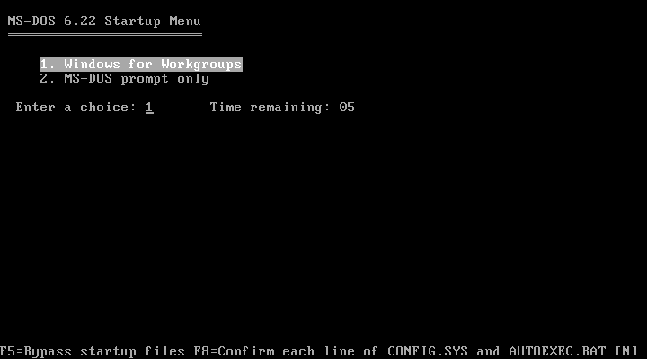
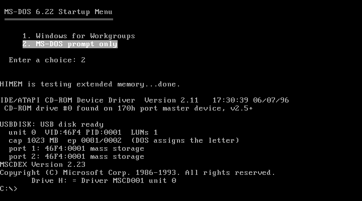
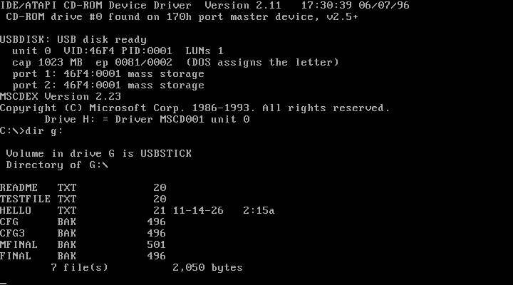

# qemu-mcp

MCP server for driving QEMU from a model that cannot see: exact text when the
guest is in text mode, OCR when it is graphical, and a screenshot when a
vision model or a human has to look.

## Quick start

```jsonc
vm_create_disk { path: "vm/disk.qcow2", sizeMb: 512 }
vm_launch      { disk: "vm/disk.qcow2", memoryMb: 32, serial: true }
wait_for_text  { pattern: "C:\\>", timeoutMs: 60000 }
type_text      { text: "dir" }
press          { keys: "ret" }
screen_text
vm_quit
```

Node 20 or newer, QEMU, and an OCR engine for graphical screens. Text-mode
guests need no OCR.

## Install

```sh
git clone https://gitlab.gotham.local/ob/qemu-mcp.git
cd qemu-mcp
npm install
node scripts/mcp/server.mjs
```

Or link it globally and register it with OpenCode in one step:

```sh
npm link
qemu-mcp --version
# then, per project:
opencode mcp add qemu --global -- qemu-mcp
```

Installer scripts are also included:

```sh
# Linux / macOS
scripts/install.sh
scripts/uninstall.sh

# Windows
scripts\install.cmd
scripts\uninstall.cmd
```

The installers register `qemu` with OpenCode, Claude Code, Gemini CLI, Codex,
and Cursor when those harnesses are present, asking before each one. Run
`scripts/install.sh --all` (or `scripts\install.cmd -all`) to register every
detected harness without prompting. The scripts are safe to rerun. The server
speaks MCP on stdin/stdout and writes diagnostics to stderr only.

## What it looks like

`wait_for_text` caught the MS-DOS startup menu, `type_text` chose the DOS
prompt, and `screen_text` read the result without OCR. Every image here is a
real `screendump` from a Windows for Workgroups 3.11 guest driven by qemu-mcp.



`screen_text` reads the 80x25 VGA plane directly, so the boot log and the
prompt come back exactly:



`fat_build` wrote this FAT image; the guest is showing `dir g:` on the USB
stick:



## How it works

- `vm_launch` picks a free QMP port per launch, so two sessions do not collide.
- `snapshot: true` boots from a temporary overlay and never writes the base disk.
- `screen_text` reads VGA text memory on an 80x25 screen. No OCR, no guessing.
  It falls back to OCR for graphics.
- `wait_for_idle` watches the framebuffer until it stops changing, so an agent
  can tell that a keypress or command actually repainted the guest.
- `vm_log` and `vm_events` explain a failed boot or an unexpected stop.

## Reading the screen

| Goal | Tool |
| --- | --- |
| Read a prompt, dialog, or command output | `screen_text` |
| Wait for boot or a prompt | `wait_for_text` |
| Know the guest repainted | `wait_for_idle`, `screen_hash` |
| Icons, custom fonts, damaged graphics | `screenshot` |

`screen_text` accepts `mode: "auto" | "vga" | "ocr"` and a `crop`
(`x`, `y`, `w`, `h`). A crop uses the OCR path; `mode: "vga"` with a crop is
rejected because VGA text is read as a character grid. Set `savePng: true` to
keep a screenshot next to the text for a vision model. `screen_ascii` is a
luminance fallback, not a text reader.

## Tools

VM lifecycle, screen reading, input, serial, FAT images, raw QMP, and macros.
The full reference, options, and limits are in
[docs/tools.md](docs/tools.md).

## Connect

Any local stdio client works; launch `qemu-mcp` with no arguments. OpenCode:

```jsonc
{
  "$schema": "https://opencode.ai/config.json",
  "mcp": {
    "servers": {
      "qemu": {
        "type": "local",
        "command": ["qemu-mcp"],
        "cwd": "."
      }
    }
  }
}
```

Claude Code, Codex, Cursor, and Gemini CLI use the same command. The server
uses its process working directory for `vm/disk.qcow2` and relative paths;
pass absolute paths when the client cannot set a working directory.

## Configuration

| Variable | Default | Purpose |
| --- | --- | --- |
| `QEMU_BIN` | `C:\Program Files\qemu\qemu-system-i386.exe` on Windows, `qemu-system-i386` elsewhere | QEMU binary |
| `QEMU_IMG` | next to `QEMU_BIN` | `qemu-img` binary |
| `QEMU_DISK` | `./vm/disk.qcow2` | default disk |
| `QEMU_MONITOR_PORT` | unset: a free port per launch | pin the QMP port |
| `QEMU_DISPLAY` | `gtk` on Windows, `none` elsewhere | QEMU display backend |
| `QEMU_MCP_SHOTS` | `./vm/shots/mcp` | where screenshots are written |
| `QEMU_MCP_MACROS` | bundled `scripts/mcp/macros` | macro directory |
| `QEMU_MCP_OCR` | `auto` | `auto`, `windows`, or `tesseract` |
| `QEMU_MCP_TESSERACT` | `tesseract` | Tesseract binary |
| `QEMU_MCP_OCR_LANG` | `eng` | Tesseract language |
| `QEMU_MCP_OCR_PSM` | `6` | Tesseract page segmentation |

Linux and macOS need Tesseract for graphical OCR:

```sh
sudo apt install tesseract-ocr     # Debian / Ubuntu
sudo dnf install tesseract         # Fedora
brew install tesseract             # macOS
```

## Limits

- `fat_build` writes FAT16 only, between about 2.2 MiB and 512 MiB. Smaller
  images would be FAT12 to DOS; FAT12 writing is not implemented.
- One VM per server process.
- OCR quality depends on the engine and the guest font.
- `screen_text` reads 80x25 colour text mode only; 40-column and MDA screens
  use OCR.
- `click_at` needs a guest driver for the USB tablet.
- The serial chardev is a TCP socket, so output is buffered from the first
  `serial_read` connection onward.
- `screen_ascii` is for graphics, not for reading text.

## Docs

- [Tool reference](docs/tools.md)

## License

MIT. See `LICENSE`.
