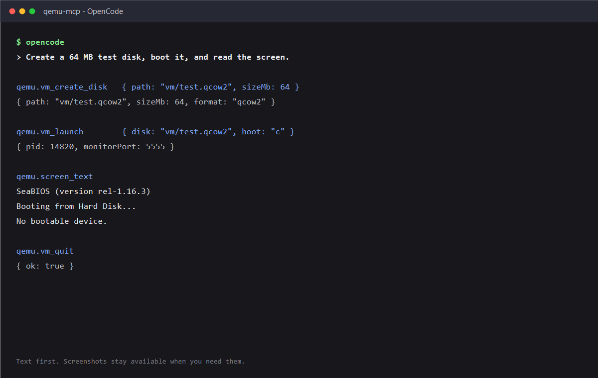
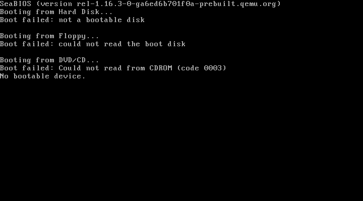

# qemu-mcp

MCP server for controlling QEMU over QMP and the human monitor. The control loop is text-first: capture the screen as OCR text or ASCII, send keys and text, and keep raw PNG screenshots for when a vision model or a human needs to look.



## What it does

- Starts, resets, and stops QEMU from an MCP client.
- Reads the guest screen as OCR text, ASCII, or PNG.
- Types text and sends key sequences.
- Moves the mouse and changes button state.
- Creates qcow2/raw/VMDK/VDI/VPC disks with `qemu-img`.
- Lists and reads FAT12/FAT16 images; builds FAT16 images.
- Runs named macros from `scripts/mcp/macros/`.
- Exposes raw monitor commands and QMP calls when the typed tools are not enough.

## Requirements

- Node.js 20 or newer.
- QEMU with `qemu-system-i386` and `qemu-img`.
- An OCR engine for `screen_text` and `wait_for_text`:
  - Windows: the built-in Windows OCR engine via PowerShell.
  - Linux and macOS: Tesseract (`tesseract` on `PATH`).
  - `screen_ascii` and `screenshot` work without OCR.

QEMU defaults to `C:\Program Files\qemu\qemu-system-i386.exe`. Set these to override it:

| Variable | Default | Purpose |
| --- | --- | --- |
| `QEMU_BIN` | `C:\Program Files\qemu\qemu-system-i386.exe` | QEMU system binary |
| `QEMU_IMG` | next to `QEMU_BIN` | `qemu-img` binary |
| `QEMU_DISK` | `./vm/disk.qcow2` | default disk when `vm_launch` omits `disk` |
| `QEMU_MONITOR_PORT` | `5555` | QMP monitor port |
| `QEMU_MCP_MACROS` | bundled `scripts/mcp/macros` | macro directory override |
| `QEMU_MCP_OCR` | `auto` | `auto`, `windows`, or `tesseract` |
| `QEMU_MCP_TESSERACT` | `tesseract` | Tesseract binary |
| `QEMU_MCP_OCR_LANG` | `eng` | Tesseract language |
| `QEMU_MCP_OCR_PSM` | `6` | Tesseract page segmentation mode |

Install Tesseract:

```sh
# Ubuntu / Debian
sudo apt install tesseract-ocr

# Fedora
sudo dnf install tesseract

# macOS
brew install tesseract
```

Windows uses its built-in OCR engine; no extra package is required.

## Install

Global install from GitHub:

```sh
npm install -g github:onionbutties/qemu-mcp
qemu-mcp --version
```

Run without installing:

```sh
npx -y github:onionbutties/qemu-mcp
```

From a clone:

```sh
git clone https://github.com/onionbutties/qemu-mcp.git
cd qemu-mcp
npm install
node scripts/mcp/server.mjs
```

The server uses its process working directory for the default disk (`./vm/disk.qcow2`) and for relative paths passed to `vm_create_disk`, `vm_launch`, `fat_*`, and the macros. In a global MCP config, set the client's working directory to the project that owns the VM, or pass absolute paths. Clients that do not expose a working directory setting should use absolute paths or `QEMU_DISK`.

## Client setup

### OpenCode

Global:

```sh
opencode mcp add qemu --global -- qemu-mcp
```

Project config (`.opencode/opencode.json` or `opencode.json`):

```jsonc
{
  "$schema": "https://opencode.ai/config.json",
  "mcp": {
    "servers": {
      "qemu": {
        "type": "local",
        "command": ["qemu-mcp"],
        "cwd": "."
      }
    }
  }
}
```

Without a global install, use `npx`:

```sh
opencode mcp add qemu --global -- npx -y github:onionbutties/qemu-mcp
```

### Claude Code

Global user scope:

```sh
claude mcp add --scope user qemu -- qemu-mcp
```

Without a global install:

```sh
claude mcp add --scope user qemu -- npx -y github:onionbutties/qemu-mcp
```

Project scope writes `.mcp.json`:

```sh
claude mcp add --scope project qemu -- qemu-mcp
```

### Codex

Add to `~/.codex/config.toml`:

```toml
[mcp_servers.qemu]
command = "qemu-mcp"
args = []
```

With `npx`:

```toml
[mcp_servers.qemu]
command = "npx"
args = ["-y", "github:onionbutties/qemu-mcp"]
```

### Cursor

Add to `~/.cursor/mcp.json` for all projects, or `.cursor/mcp.json` for one project:

```json
{
  "mcpServers": {
    "qemu": {
      "type": "stdio",
      "command": "qemu-mcp",
      "args": []
    }
  }
}
```

With `npx`:

```json
{
  "mcpServers": {
    "qemu": {
      "type": "stdio",
      "command": "npx",
      "args": ["-y", "github:onionbutties/qemu-mcp"]
    }
  }
}
```

### Gemini CLI

Global user scope:

```sh
gemini mcp add -s user qemu qemu-mcp
```

Without a global install:

```sh
gemini mcp add -s user qemu npx -- -y github:onionbutties/qemu-mcp
```

### Other MCP clients

Any client that supports local stdio servers can launch `qemu-mcp` with no arguments. The server speaks MCP on stdin/stdout and writes diagnostics to stderr only.

## Tools

| Tool | Purpose |
| --- | --- |
| `vm_status` | Running state, PID, monitor port, disk, last error |
| `vm_create_disk` | Create a disk with `qemu-img` (`qcow2`, `raw`, `vmdk`, `vdi`, `vpc`) |
| `vm_launch` | Start QEMU; the disk must exist |
| `vm_quit` | Stop QEMU |
| `vm_reset` | Reset the running guest |
| `send_key` | Send a QEMU key sequence such as `ret` or `ctrl-alt-del` |
| `type_text` | Type ASCII text |
| `press` | Press a key sequence, optionally with a hold time |
| `mouse_move` | Move the mouse by a relative delta |
| `mouse_button` | Set button state; bitmask `1` left, `2` right, `4` middle |
| `monitor_command` | Run a human monitor command |
| `qmp_execute` | Run a QMP command with JSON arguments |
| `screenshot` | Capture a PNG and return it as MCP image content plus a path |
| `screen_text` | Capture and OCR the screen |
| `screen_ascii` | Capture and render the screen as ASCII, with optional crop |
| `wait_for_text` | Poll until text or a regex appears |
| `fat_list` | List a FAT12/FAT16 image |
| `fat_read` | Read a file; use `encoding: "base64"` for binary payloads |
| `fat_build` | Build a FAT16 image from host files |
| `macro_list` | List macros |
| `macro_run` | Run a macro by name |

## Example

```text
vm_create_disk { path: "vm/disk.qcow2", sizeMb: 512, format: "qcow2" }
vm_launch      { disk: "vm/disk.qcow2", diskFormat: "qcow2", boot: "c" }
wait_for_text  { pattern: "C:\\>", timeoutMs: 30000 }
type_text      { text: "dir" }
press          { keys: "ret" }
screen_text
vm_quit
```



## Screen output

`screen_text` returns OCR text from the current frame. `screen_ascii` returns a luminance rendering and accepts `cols`, `rows`, and `crop` (`x`, `y`, `w`, `h`). `screenshot` returns the PNG as MCP image content and leaves the file in `vm/shots/mcp/`.

OCR is useful for text-mode screens and dialog boxes. It is not reliable for icon-only toolbars, custom fonts, or damaged graphics. Use `screenshot` for those cases and pass the image to a vision model or a human.

## Macros

Macros are ESM modules in `scripts/mcp/macros/`. Each module exports a default async function:

```js
export default async function myMacro(session, args) {
  await session.command('sendkey ret');
  return { ok: true };
}
```

Set `QEMU_MCP_MACROS` to use a different directory. `macro_run` reloads the module when its mtime changes, so edits take effect without restarting the server.

## Development

```sh
npm install
npm test
```

Tests cover the FAT reader, screen helpers, VM session locking, tool registration, raw text results, and the stdio server's tool catalog.

## Limits

- One VM session per MCP server process.
- OCR quality depends on the engine and the guest's font rendering. Tesseract works best with clean, high-contrast text screens.
- The server drives a GUI guest through keyboard and mouse; it does not provide pixel-level element lookup.
- `fat_build` writes FAT16 only. `fat_list` and `fat_read` accept FAT12 and FAT16.
- QEMU paths are configurable, but the default machine profile (`machine.mjs`) is a 32-bit PC with IDE, USB UHCI, and Sound Blaster 16 support.

## License

MIT. See `LICENSE`.
